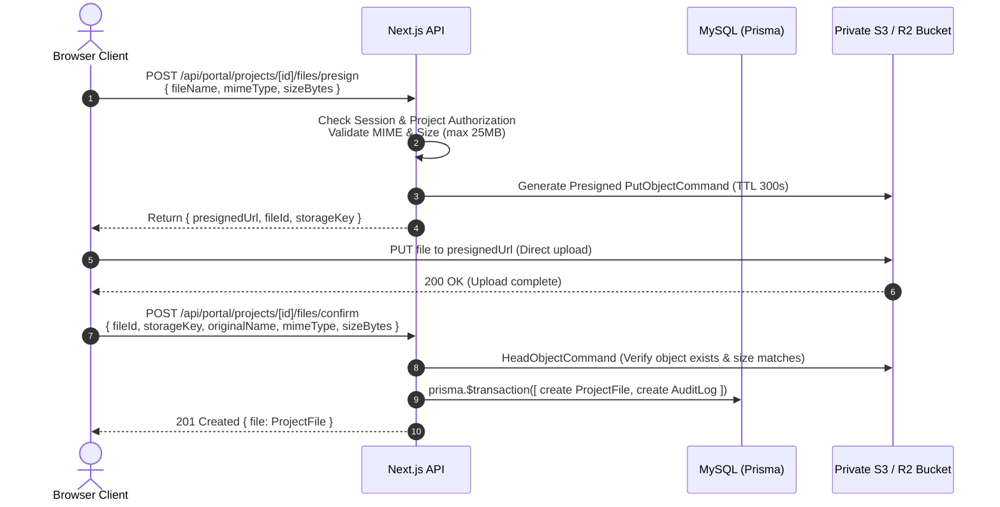

# Nova — Project Messaging and Private File Storage Architecture Design (Phase 4A)

**Status:** Planned / Approved Design  
**Date:** 2026-10-11  
**Scope:** Client Portal (`/portal/projects/[id]`) and Admin CRM (`/admin/projects/[id]`)  

---

## 1. Executive Summary & Existing Implementation Findings

### 1.1 Current State Analysis
A thorough review of the current Nova codebase reveals the following baseline:

* **Prisma Schema Models (`prisma/schema.prisma`)**:
  * `Message`: Model exists with `id`, `projectId`, `authorId` (`String`), `body` (`Text`), `createdAt` (`DateTime`), and `project` relation (`onDelete: Cascade`). An index exists on `[projectId, createdAt]`.
    * *Finding*: `authorId` is a standalone string without a direct relational foreign key to `User`. This avoids schema-level constraints on message deletion if users are pruned, but requires application-level author resolution.
  * `ProjectFile`: Model exists with `id`, `projectId`, `storageKey` (`String @unique`), `originalName` (`String`), `mimeType` (`String`), `sizeBytes` (`Int`), `createdAt` (`DateTime`), and `project` relation (`onDelete: Cascade`).
    * *Finding*: `uploadedById` is not stored directly on `ProjectFile`. Uploader identity must be tracked via `AuditLog` (`action: "FILE_UPLOAD", actorId: session.user.id`).
* **Existing Project Access Layer (`src/lib/project-access.ts`)**:
  * `getAuthorizedProject(projectId)` enforces strict server-side scoping:
    * Rejects malformed or non-CUID project IDs immediately.
    * Allows `ADMIN` users only if `canOpenAdmin(role, twoFactorEnabled)` is satisfied (role is `ADMIN` **and** TOTP MFA is verified).
    * Restricts `CLIENT` users to projects matching `clientId: session.user.id`.
    * Returns `null` on unauthorized or non-existent projects.
* **Storage Configuration (`.env.example`)**:
  * Contains placeholders for `PRIVATE_STORAGE_BUCKET`, `PRIVATE_STORAGE_ACCESS_KEY`, and `PRIVATE_STORAGE_SECRET_KEY`.
  * *Finding*: Missing `PRIVATE_STORAGE_REGION` and `PRIVATE_STORAGE_ENDPOINT` required for S3-compatible alternatives (Cloudflare R2, MinIO, Wasabi).
* **Missing Components**:
  * No routes, API handlers, or UI components exist for messaging or file management.
  * No object storage SDK (e.g., AWS SDK) is currently installed in `package.json`.

---

## 2. Project Membership & Access Model Resolution

### 2.1 Current Architecture Evaluation
* Currently, every `Project` is associated with a single client owner via `clientId: String` referencing `User.id`.
* **Decision for Phase 4**: The single `clientId` model is **fully sufficient, secure, and appropriate** for Phase 4 messaging and file storage.
  * Every message and file belongs strictly to a `Project`.
  * Authorization inherits directly from the project boundary: if a user is authorized for the project (`project.clientId === session.user.id` or MFA-verified `ADMIN`), they are authorized to access the project's messages and files.
  * This avoids premature schema complexity while ensuring zero cross-tenant leakage.

### 2.2 Future Multi-User Membership Specification (Deferred)
If multiple client accounts within the same organization must share a single project in future phases, the following junction model is planned:

```prisma
model ProjectMember {
  id        String   @id @default(cuid())
  projectId String
  userId    String
  role      String   @default("COLLABORATOR") // OWNER, COLLABORATOR, VIEWER
  createdAt DateTime @default(now())
  project   Project  @relation(fields: [projectId], references: [id], onDelete: Cascade)
  user      User     @relation(fields: [userId], references: [id], onDelete: Cascade)

  @@unique([projectId, userId])
  @@index([userId])
}
```
*No schema migration is required or applied in Phase 4A.*

---

## 3. Project Messaging Architecture

### 3.1 Core Principles
1. **Zero Cross-Client Leakage**: Messages are scoped exclusively through verified project ownership. Client A cannot read, post, or modify messages in Client B's project.
2. **Server-Side Sender Integrity**: The `authorId` is always taken directly from the verified `session.user.id` on the server. The client cannot supply or spoof `authorId`.
3. **Immutability & Auditability**: Messages are append-only. No arbitrary edits or deletions without explicit administrative audit logs.
4. **Input Validation**: Strict Zod validation on message bodies (1 to 4,000 characters, trimmed, rejects empty/whitespace-only bodies).
5. **Safe Rendering**: All message text is rendered as plain React text nodes with CSS `white-space: pre-wrap; word-break: break-word;` to guarantee immunity against XSS.

### 3.2 Data Flow & Query Strategy
* **Read Messages (`GET /api/portal/projects/[id]/messages`)**:
  * Validates session and checks project access via `getAuthorizedProject(id)`.
  * Fetches messages with cursor-based or offset pagination, ordered chronologically (`createdAt: asc`).
  * Enriches author metadata (`name`, `role`) by resolving `authorId` from the `User` table without exposing emails or credentials.
* **Post Message (`POST /api/portal/projects/[id]/messages`)**:
  * Validates session, checks project access, and validates body length.
  * Inserts message into `Message` table with `projectId` and `authorId: session.user.id`.
  * If the sender is an `ADMIN`, records an entry in `AuditLog` (`action: "ADMIN_MESSAGE_POSTED"`).

---

## 4. Private Object Storage Architecture

### 4.1 Technology Recommendation
* **Recommended Adapter**: Official AWS SDK v3 packages:
  * `@aws-sdk/client-s3`
  * `@aws-sdk/s3-request-presigner`
* **Rationale**: AWS SDK v3 is modular, tree-shakeable, and the de facto standard compatible with AWS S3, Cloudflare R2, MinIO, Wasabi, and Google Cloud Storage interoperability mode.

### 4.2 Security Architecture & Private-by-Default Bucket
* **Public Access Block**: The storage bucket must have **100% public access blocked**. Direct HTTP access to object URLs will always return `403 AccessDenied`.
* **Zero Secret Exposure**: AWS/R2 credentials (`ACCESS_KEY`, `SECRET_KEY`) reside purely on the server. They are never sent to the client bundle or included in API responses.
* **Deterministic, Unpredictable Storage Keys**:
  * Client filenames are never used as storage keys to prevent path traversal (`../`) and key collisions.
  * Storage Key Format:
    ```
    projects/{projectId}/files/{fileId}/{randomUuid}.{sanitizedExtension}
    ```
  * The original file name is stored only as database metadata in `ProjectFile.originalName`.

### 4.3 Presigned Two-Step Upload Flow


### 4.4 Authorized Short-Lived Downloads
* **Endpoint**: `GET /api/portal/projects/[id]/files/[fileId]/download`
* **Authorization**: Server validates session and verifies the requesting user owns or administers the project.
* **Presigning**: Server issues a `GetObjectCommand` presigned URL with:
  * `ResponseContentDisposition: attachment; filename="{originalName}"`
  * Short TTL: **60 seconds**.
* **Response**: HTTP 302/307 redirect to the temporary presigned URL.

### 4.5 Content Validation & Allowed Types
* **File Size Limit**: Maximum 25 MB per upload.
* **Allowed MIME Types Allowlist**:
  * Documents: `application/pdf`, `text/plain`, `application/msword`, `application/vnd.openxmlformats-officedocument.wordprocessingml.document`
  * Spreadsheets: `text/csv`, `application/vnd.ms-excel`, `application/vnd.openxmlformats-officedocument.spreadsheetml.sheet`
  * Images: `image/png`, `image/jpeg`, `image/webp`, `image/svg+xml`
  * Archives: `application/zip`, `application/x-zip-compressed`
* **Magic-Number / Sniffing Guard**: Beyond the client-reported header, the confirmation step executes an S3 `HeadObject` check and validates file extensions against the MIME allowlist. Executable binaries (`.exe`, `.bat`, `.sh`, `.cmd`, `.js`, `.html`) are strictly rejected.

---

## 5. Authorization Matrix

| Operation | Route | Role Required | MFA Required? | Scoping Enforcement |
| :--- | :--- | :--- | :---: | :--- |
| **List Messages** | `GET /api/portal/projects/[id]/messages` | `CLIENT` or `ADMIN` | Yes for `ADMIN` | `clientId === session.user.id` or MFA Admin |
| **Send Message** | `POST /api/portal/projects/[id]/messages` | `CLIENT` or `ADMIN` | Yes for `ADMIN` | `clientId === session.user.id` or MFA Admin |
| **List Files** | `GET /api/portal/projects/[id]/files` | `CLIENT` or `ADMIN` | Yes for `ADMIN` | `clientId === session.user.id` or MFA Admin |
| **Presign Upload** | `POST /api/portal/projects/[id]/files/presign` | `CLIENT` or `ADMIN` | Yes for `ADMIN` | `clientId === session.user.id` or MFA Admin |
| **Confirm Upload** | `POST /api/portal/projects/[id]/files/confirm` | `CLIENT` or `ADMIN` | Yes for `ADMIN` | `clientId === session.user.id` or MFA Admin |
| **Download File** | `GET /api/portal/projects/[id]/files/[fileId]/download` | `CLIENT` or `ADMIN` | Yes for `ADMIN` | File belongs to authorized project |
| **Delete File** | `DELETE /api/portal/projects/[id]/files/[fileId]` | `CLIENT` or `ADMIN` | Yes for `ADMIN` | File belongs to authorized project; writes `AuditLog` |

---

## 6. Proposed Routes and UI Locations

### 6.1 Client Portal UI
* **`/portal/projects/[id]`**:
  * Add summary cards for **Recent Messages** and **Project Assets**.
  * Add direct links to full message thread and file depository.
* **`/portal/projects/[id]/messages`**:
  * Dedicated responsive discussion thread with message history, author indicators ("Studio Team" vs "Client"), and input form.
* **`/portal/projects/[id]/files`**:
  * File depository table listing file name, size, upload date, download action, and upload modal/dropzone.

### 6.2 Admin CRM UI
* **`/admin/projects`**: Admin directory of client engagements.
* **`/admin/projects/[id]`**: Dedicated administrative engagement view containing tabs for Scope, Milestones, Tasks, Client Discussion, Files, and Audit History.

---

## 7. Required Environment Variables

Update `.env.example` with the following variables:
```ini
# Private File Storage (AWS S3, Cloudflare R2, MinIO, or Wasabi)
PRIVATE_STORAGE_BUCKET="nova-client-files-dev"
PRIVATE_STORAGE_REGION="auto"
PRIVATE_STORAGE_ENDPOINT="" # Optional: required for Cloudflare R2 or local MinIO
PRIVATE_STORAGE_ACCESS_KEY=""
PRIVATE_STORAGE_SECRET_KEY=""
```

---

## 8. Comprehensive Test Plan

### 8.1 Mocked Unit Tests (`npm test`)
* **Message Validation**: Test Zod schema rejects empty strings, whitespace, >4,000 characters, and HTML tags.
* **Storage Key Generator**: Verify storage key generates non-colliding UUIDs, strips path traversal (`../../`), and formats clean extensions.
* **MIME & Size Validator**: Verify allowlist admits valid PDFs/images and rejects executables and oversized files.
* **Presigner Mock**: Verify presigned URL generator creates valid query parameters with expected expiration TTLs.

### 8.2 Real Database Integration Tests (`npm run test:integration`)
* **Cross-Client Message Isolation**:
  * Client A creates a message in Project A.
  * Client B requests Project A messages $\to$ returns 404 / `null`.
  * Client B attempts to POST a message into Project A $\to$ rejected with 404.
* **Cross-Client File Metadata Isolation**:
  * Client A confirms a file in Project A.
  * Client B attempts to download or delete Client A's file $\to$ rejected with 404.
* **Chronological Ordering**: Verify multiple messages return strictly sorted by `createdAt: asc`.
* **Atomic Transactions & Audit Logs**:
  * Verify file confirmation atomically creates `ProjectFile` and `AuditLog`.
  * Verify simulated failure rolls back cleanly without leaving orphan database records.
* **Admin Privilege Scoping**:
  * Admin with verified MFA can access project messages and files.
  * Admin without verified MFA is rejected with 403.

### 8.3 Storage Integration Tests (Staging / Dev with S3 / MinIO)
* Uploading via presigned URL succeeds with matching content type and size.
* Mismatched content size or type causes S3 verification failure on confirmation.
* Download redirect yields temporary URL valid for 60 seconds; expired URL returns S3 403.
* File deletion cleans up both database record and S3 object.

---

## 9. Ordered Implementation Plan (Phase 4B+)

1. **Step 1: Dependency Installation**:
   * Add `@aws-sdk/client-s3` and `@aws-sdk/s3-request-presigner` to `package.json`.
2. **Step 2: Core Storage & Messaging Libraries**:
   * Create `src/lib/storage.ts`: S3 client initialization, presigned PUT/GET helpers, mock fallback for local dev without cloud keys.
   * Create `src/lib/messages.ts`: Message query helpers and Zod validation schemas.
3. **Step 3: API Route Implementation**:
   * Implement `/api/portal/projects/[id]/messages` (`GET`, `POST`).
   * Implement `/api/portal/projects/[id]/files/presign` (`POST`).
   * Implement `/api/portal/projects/[id]/files/confirm` (`POST`).
   * Implement `/api/portal/projects/[id]/files/[fileId]/download` (`GET`).
   * Implement `/api/portal/projects/[id]/files/[fileId]` (`DELETE`).
4. **Step 4: Client Portal UI**:
   * Implement `/portal/projects/[id]/messages/page.tsx` and discussion UI component.
   * Implement `/portal/projects/[id]/files/page.tsx` and file upload/download UI component.
   * Update `/portal/projects/[id]/page.tsx` overview with message and file preview widgets.
5. **Step 5: Automated Testing**:
   * Add unit tests in `src/lib/messages.test.ts` and `src/lib/storage.test.ts`.
   * Add database integration tests in `src/lib/messaging-files.integration.test.ts`.
6. **Step 6: Verification & Documentation**:
   * Run full test suite, lint, typecheck, production build, and update `docs/IMPLEMENTATION-STATUS.md`.
